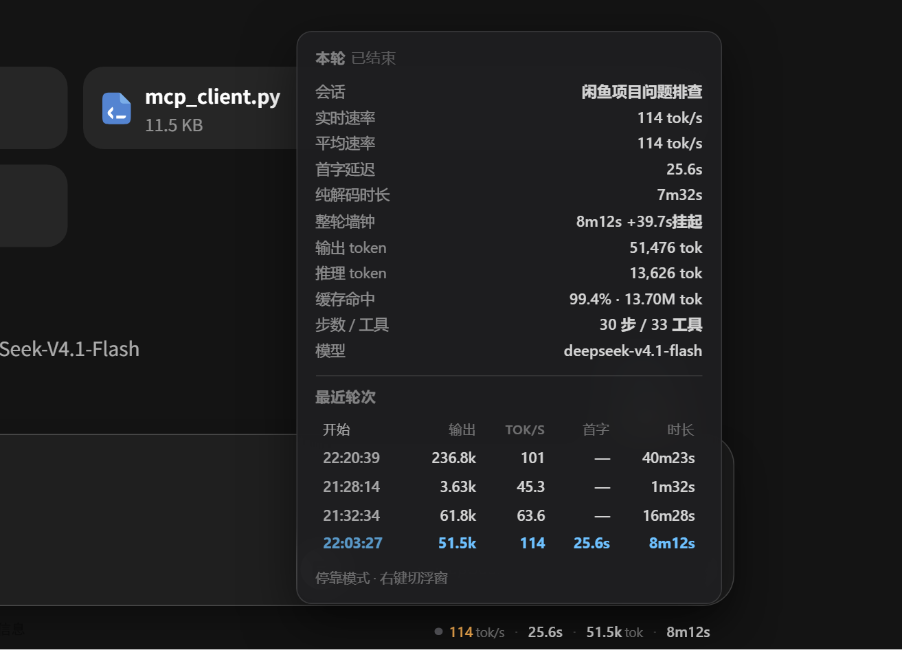

# WorkBuddy TPS Monitor

给 [WorkBuddy](https://www.workbuddy.cn) 加一条**输入框里的实时速率条**——像 DeepSeek Harness 的 StatsPills 那样，
显示 `tok/s · 首字 · 输出 · 时长`，点击展开完整用量明细。

WorkBuddy 自己只显示「预计消耗 1.1 ~ 48.4」和「已处理 47m9s」，**没有任何 tok/s 概念**。
这个项目从它已经落盘的 transcript 和运行日志里，把真实速率还原出来。

零侵入：不装插件、不改 `app.asar`、不改 WorkBuddy 源码。全部读它自己写的文件，外加一层 DOM 覆盖。




---

## 效果

停靠在输入框底部那行「内容由 AI 生成，请核实重要信息」的右侧，跟着输入框走，不遮挡任何按钮：

```text
┌─ 输入框 ───────────────────────────────────────┐
│  今天帮你做些什么？@ 添加上下文，/调用技能与指令      │
│  ＋  ⚠️允许完全访问      DeepSeek-V4.1-Flash  ⬆    │
└────────────────────────────────────────────────┘
   内容由 AI 生成，请核实重要信息   ● 114 tok/s · 25.6s · 51.5k tok · 8m12s
                                            ↑ 停靠在这里
```

- **流式中**：绿色脉冲点 + 蓝色数字（实时速率）
- **已结束**：琥珀色数字（该轮的权威平均速率）
- **无数据**（历史会话 / 该轮没有 usage）：全部显示 `—`，不瞎估
- **右键** pill：在「停靠 / 浮窗」之间切换，选择持久化
- **左键** pill：展开 12 行明细 + 最近 6 轮历史表

---

## 快速开始

### 前置条件

| 要求 | 说明 |
|---|---|
| **Node.js ≥ 22** | 用到全局 `WebSocket`，无需任何依赖包 |
| **WorkBuddy 桌面版** | 在 5.9.3 / Electron 37.10.3 上验证 |
| **调试端口** | WorkBuddy 需带 `--remote-debugging-port=9222` 启动（HUD 注入用） |

WorkBuddy 的 Electron fuse 默认就是开的（`RunAsNode=1`、`EnableNodeCliInspectArguments=1`），
所以加启动参数直接可用，不需要改二进制。

### 第一步：让 WorkBuddy 带调试端口启动

改快捷方式的目标，或从命令行启：

```powershell
& "$env:LOCALAPPDATA\Programs\WorkBuddy\WorkBuddy.exe" --remote-debugging-port=9222
```

> 装了 [WorkDaddy](https://github.com/zzr767299) 的话，它拉起 WorkBuddy 时已经带了这个参数，跳过这步。

### 第二步：自检

```powershell
cd workbuddy-tps
node tps.mjs selfcheck
```

六项全 ✔ 就说明环境通了：

```text
WorkBuddy TPS Monitor 自检
  node            v24.16.0
  WB_HOME         C:\Users\ZZR\.workbuddy  ✔
  transcripts     45 个  ✔
  最近会话         fbf09462-…  4 轮  ✔
  末轮             51476 tok / 113.8 tok/s / 30 步
  实时日志         fbf09462-….log  ✔
  实时解析         chars=54763 chunks=58 tools=33 ttft=25622ms  ✔
  CDP :9222        WorkBuddy 页面已连上  ✔
  SessionEnd hook  已配置（可复用）  ✔
```

### 第三步：注入

```powershell
node tps.mjs hud              # 常驻，Ctrl+C 退出
node tps.mjs hud --once       # 只注入一次
node tps.mjs hud --mode float # 以浮窗形式注入
```

---

## 四种形态

### A. 界面内速率条（推荐）

见上方截图。`node tps.mjs hud` 注入后常驻，WorkBuddy 刷新页面会自动补注入，渲染进程重启会自动重连。

### B. 桌面悬浮窗

```powershell
powershell -ExecutionPolicy Bypass -File WbTps.ps1
```

无边框置顶小窗，左边缘竖条随状态变色（灰=空闲 / 绿=流式中 / 琥珀=已结束）。
右键展开 14 行明细。**不需要调试端口**——走 `tps.mjs stream`，纯读本地文件。


### C. 会话结束自动出报表

```powershell
node install.mjs            # 往 settings.json 的 hooks.SessionEnd 追加一条
node install.mjs --dry      # 只看会写什么
node install.mjs --uninstall
```

会**追加**在已有 hook 后面（幂等去重），不覆盖你原有的配置。
每轮结束写一份到 `~/.workbuddy-tps/reports/`。

### D. JSON 流（接任何东西）

```powershell
node tps.mjs stream --interval 800 --out state.json
```

```json
{
  "ts": 1794318671902,
  "sessionId": "fbf09462-bcee-4de7-9102-16e31b3de349",
  "title": "闲鱼项目问题排查",
  "running": false,
  "liveTps": 0, "avgTps": 71, "ttftMs": 14468,
  "chars": 99397, "tools": 33,
  "turn": {
    "outputTokens": 51476, "reasoningTokens": 13626,
    "tpsDecode": 114.0, "wallMs": 493000, "idleMs": 39700,
    "steps": 30, "model": "deepseek-v4.1-flash",
    "cacheHitPct": 99.4, "contextTokens": 497152
  }
}
```

托盘程序、Rainmeter、Stream Deck、OBS 文本源都能直接消费。

---

## 跟随 WorkBuddy 自启

`supervisor.mjs` 是常驻监督进程：

- 等 `WorkBuddy.exe` 出现
- 等 9222 调试端口通
- spawn `tps.mjs hud` 作为子进程
- 子进程挂了自动重启（3s → 60s 指数退避，单实例保护）
- WorkBuddy 退出超过 5 分钟，自己也退出，不留孤儿
- WorkBuddy 重启回来，自动重新接管

安装到开机自启（写入 `HKCU\...\Run`，和 WorkBuddy 自己那条并列，用 wscript 隐藏启动）：

```powershell
powershell -ExecutionPolicy Bypass -File install-autostart.ps1
powershell -ExecutionPolicy Bypass -File install-autostart.ps1 -Uninstall
```

```text
WorkBuddy.WorkBuddy : G:\Software\WorkBuddy\WorkBuddy.exe
WorkBuddyTPS        : wscript.exe "...\run-hidden.vbs"     ← 无窗口
```

日志：`~/.workbuddy-tps/supervisor.log`

---

## 切换会话怎么算

三个独立的对齐机制，三重保险：

| 锚点 | 位置 | 作用 |
|---|---|---|
| **会话** | `.cr-document[data-root-id]` 就是 sessionId | 变了就清 HUD authority、清 live 缓存、补写上一轮报表 |
| **轮次** | `[data-cr-frame][data-status != "complete"]` | 转 complete 那一刻落报表（按 turnId 去重） |
| **数据** | transcript 缓存的 **mtime** | 有新 usage 落盘就重解析，没变就复用 |

三种数据态，显示来源不同：

| 场景 | 速率来源 | 显示 |
|---|---|---|
| 正在流式 | DOM 字符增量 ÷ 时间 | 蓝色实时值 + 绿点脉冲 |
| 已结束、有 usage | `outputTokens ÷ 活跃解码时长` | 琥珀色权威值 |
| 历史会话 / 无 usage | 无 | 全部 `—` |

---

## 数据从哪来

| 数据 | 位置 | 精度 |
|---|---|---|
| **权威 token / 缓存 / 步数** | `~/.workbuddy/projects/<slug>/<sessionId>.jsonl` 的 `providerData.usage` | 精确（服务端 usage） |
| **实时流式增量** | `~/.workbuddy/logs/<date>/sdk/conversations/<cid>.log` 的 `event-machine:dispatch` | 字符级 |
| **首字时间** | 同上，`PROMPT_SENT` → 第一个 `agent_message_chunk` | 毫秒级 |
| **轮次边界** | `state-machine:transition {input:"PROMPT_SENT"}` / `TURN_COMPLETED` | 毫秒级 |
| **界面注入** | CDP `--remote-debugging-port=9222` | 需带参数启动 |

### usage 字段实测形状

```jsonc
"usage": {
  "inputTokens": 36806,
  "outputTokens": 221,                                    // 已含 reasoning
  "inputTokensDetails":  [{ "cached_tokens": 8320 }],
  "outputTokensDetails": [{ "reasoning_tokens": 84 }]
},
"rawUsage": {
  "credit": 0.42,
  "prompt_cache_hit_tokens": 8320,
  "prompt_cache_miss_tokens": 28486,
  "completion_thinking_tokens": 84
}
```

`outputTokens` 已含 `reasoning_tokens`（DeepSeek 的 `completion_tokens` 口径），
所以 tok/s 直接 `outputTokens ÷ 解码时长`，不重复加推理。

### 日志是折叠的（最容易算错的地方）

```text
textLen                     = 本行增量
aggregated.foldedTextLen    = 该 messageId 到目前的累计长度
aggregated.foldedChunkCount = 已被折叠掉的 chunk 数
```

实测：同一轮里 `textLen` 只落了 28 个字符，但真实输出是 **29005 字符**——因为 700 多个 chunk 被折叠成 7 行。

正确算法：**每个 messageId 取 `max(foldedTextLen, ΣtextLen)` 再求和**。
取全局 `max(foldedTextLen)` 只能拿到最后一条消息的长度（2888），速率直接差 10 倍。

---

## 指标口径（三个坑）

### 1. tok/s 的分母是「活跃解码时长」，不是墙钟

一轮 8 分钟里可能挂机 40 秒。用墙钟算会得到偏低的假数字。

```text
相邻 step 间隔 > 90s 的部分 → 记为「挂起」，单独显示
活跃时长 = Σ min(gap, 90s)
```

实测同一轮：按墙钟 62 tok/s，按活跃时长 114 tok/s。

### 2. 上下文取末步 inputTokens，不累加

累加是计费口径（一轮几百万级），看上下文没意义。缓存命中率才用累加：

```text
上下文   = 末步 inputTokens
缓存命中 = cacheRead ÷ Σ inputTokens
```

### 3. tools 按 toolCallId 去重

`tool_call` 和 `tool_call_update` 会为同一次调用各发一条。直接累加得到 130 次，真实 32 次。

---

## 命令行

```text
node tps.mjs hud [--port 9222] [--once] [--mode float|dock]
node tps.mjs stream [--interval 800] [--out FILE]
node tps.mjs turn [--session ID] [--no-save]
node tps.mjs session [--session ID] [--tail N]
node tps.mjs list [--limit 12]
node tps.mjs hook --event=SessionEnd
node tps.mjs selfcheck
```

报表长这样：

```text
┌─ WorkBuddy 本轮统计 ──────────────────────────────
│ 开始      22:39:06   结束  22:44:59
│ 模型      deepseek-v4.1-flash
│ 提问      开始P3
│
│ 速率      125 tok/s（纯解码）   107 tok/s（整轮）
│ 首字      34.4s
│ 输出      37,541 tok（其中推理 10,640）
│ 上下文    535.1k tok   缓存命中 99%+
│ 时长      5m01s 活跃（另有 51.3s 挂起）
│ 步数      23   工具 25 次
│ 消耗      11.87 credits
└──────────────────────────────────────────────────
```

---

## 排错

**HUD 没出现**

```powershell
node tps.mjs selfcheck        # 先看 CDP 那项是不是 ✘
```

CDP 是 ✘ 说明 WorkBuddy 没带调试端口。关掉 WB 重新用带参数的方式启动。

**数字一直是 `—`**

该会话的 transcript 里没有带 `usage` 的轮次。新开一轮对话就有了。
如果新对话也一直 `—`，检查 `~/.workbuddy/projects/` 下有没有对应 sessionId 的 jsonl。

**数字明显偏小或偏大**

跑 `node tps.mjs turn` 对一下 transcript 里的真实 `outputTokens`。
偏差大说明日志折叠格式变了（WorkBuddy 升级），需要重新确认 `aggregated.foldedTextLen` 的语义。

**WorkBuddy 变卡**

旧版本 HUD 用 `innerText` 读 DOM 长度，长会话会拖死渲染进程。当前版本已改用 `textContent` + MutationObserver。
如果仍卡，先 `node tps.mjs hud --once` 之外不要保留常驻，并检查 `supervisor.log` 有没有反复重连。

**supervisor 起了多个 HUD**

已加单实例保护（`child` + `spawning` + `restartTimer` 三重判断）。
如果再遇到，看 `supervisor.log` 里有没有重复的「启动 HUD 子进程」。

---

## 性能注意事项

第一版每 300ms 用 `innerText` 读 DOM 长度。在 512 段、5MB 的会话里，`innerText` 每次强制同步布局，
最终把渲染进程主线程打死（CPU 100%、内存 1.2GB、CDP 完全无响应）。

当前版本的三条关键改动：

| 改动 | 效果 |
|---|---|
| `innerText` → `textContent` | 不触发布局，只读字符串 |
| 300ms 定时 → MutationObserver + 700ms 兜底 | 文本没变就不读 |
| CDP `send` 加 20s 超时 | 慢响应不会积压成雪崩 |

改完后连续 6 次往返都是 1~3ms，无退化。

WorkBuddy 渲染进程崩掉重启后，`tps.mjs` 会自己重连：

```text
[hud] CDP 断开（guard），重连中…
[hud] 重连成功，重注入: hud:dock
```

---

## 与 WorkDaddy 共存

两个独立元素，互不干扰：

```text
fab: true | wbs-root: true | hud: true | hudParent: conversation-input-area__disclaimer
```

---

## 项目结构

```text
workbuddy-tps/
├─ tps.mjs                  CLI 入口（hud / stream / turn / session / hook / selfcheck）
├─ supervisor.mjs           监督进程：跟随 WorkBuddy 起落，自动重启 HUD
├─ install-autostart.ps1    开机自启安装器（写 HKCU\...\Run）
├─ install.mjs              SessionEnd hook 安装器（改 settings.json）
├─ WbTps.ps1                桌面悬浮窗（PowerShell WinForms）
├─ start-hud.cmd            双击启动界面内 HUD（先探测调试端口）
├─ start-float.cmd          双击启动桌面浮窗
├─ src/
│  ├─ store.mjs             jsonl 权威层：turn 折叠、活跃时长、上下文
│  ├─ live.mjs              log 实时层：tail + 状态机 + 折叠字符还原
│  ├─ cdp.mjs               CDP 连接（带超时）+ DOM 探针
│  ├─ hud.mjs               注入渲染进程的 HUD（停靠 / 浮窗双形态）
│  ├─ report.mjs            文本报表渲染
│  └─ format.mjs            格式化 + token 估算
├─ test/live.test.mjs       17 个断言，用合成日志验证解析与速率
└─ docs/                    截图
```

跑测试：

```powershell
node test/live.test.mjs
# 结果：17 通过，0 失败
```

测试用合成日志造了一个 30 秒的流（3s TTFT、200 个 chunk、1 次工具调用、正常结束、重置），
验证状态机、速率计算、ttft 双口径（含思考 vs 首段正文）全部正确。

---

## 兼容性

只在 **WorkBuddy 5.9.3 / Electron 37.10.3 / Windows** 上验证过。

依赖的 WorkBuddy 内部结构：

- DOM：`.cr-document[data-root-id]` / `[data-cr-frame][data-status]` / `.cr-agent__content` /
  `.conversation-input-area__disclaimer` / `.cr-markdown`
- 日志事件：`event-machine:dispatch` / `state-machine:transition` / `runtime.applyStopReason`
- transcript：`providerData.usage` / `providerData.rawUsage` / `providerData.stepSeq` /
  `providerData.conversationRequestId`

WorkBuddy 升级后跑 `node tps.mjs selfcheck`，哪一层断了会直接体现在输出里。

如果把 HUD 的所有入口都关了（不常驻、不刷新），WorkBuddy 本身不受任何影响——
整个项目只读它的文件，只在渲染进程里插了一个独立 DOM 节点。

---

## License

[Apache License 2.0](LICENSE)
